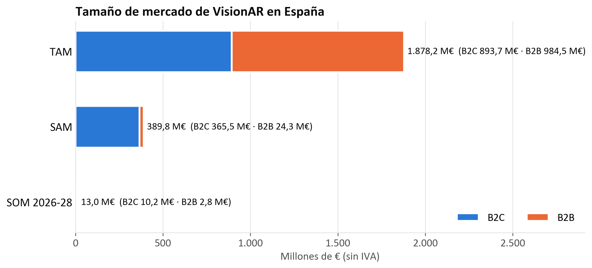
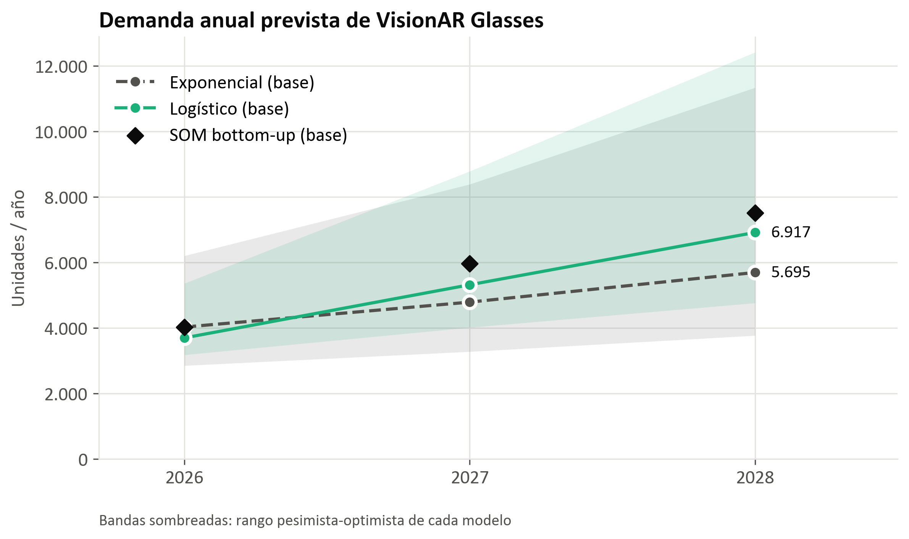
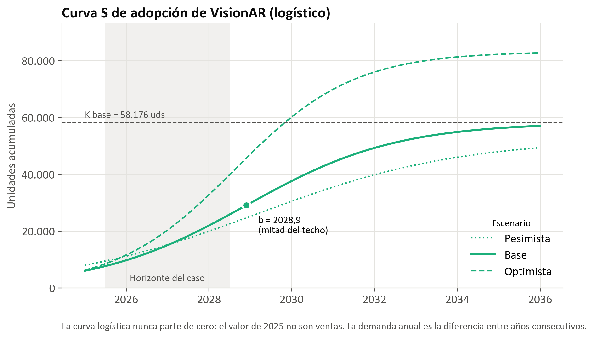
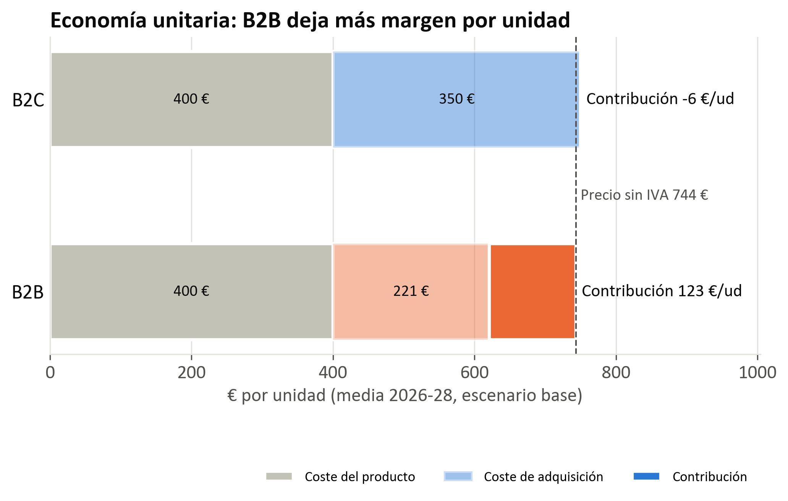

# VisionAR · Previsión de la demanda de gafas de realidad aumentada en España

Caso práctico de la asignatura **Simulación de Sistemas Logísticos (UAX)**. VisionAR es una startup que lanza en 2026 unas gafas de realidad aumentada (*VisionAR Glasses*, 900 € con IVA) para dos segmentos: consumidores (**B2C**) y empresas tecnológicas, de marketing y de seguridad privada (**B2B**).

El proyecto responde a dos preguntas:

1. **¿Cuál es el mercado?** Estimación de TAM, SAM y SOM, repartidos entre B2C y B2B, en unidades, facturación y margen.
2. **¿Cuánto se venderá entre 2026 y 2028?** Previsión de la demanda anual con dos modelos (exponencial y logístico / curva S), en tres escenarios, y un plan de producción orientativo.

Todo el cálculo está en un único script de Python reproducible ([analisis/visionar_modelo.py](analisis/visionar_modelo.py)), que genera las tablas y los gráficos usados en la presentación.

---

## Estructura del repositorio

```
Vision_AR/
├── analisis/
│   ├── visionar_modelo.py      # Modelo completo: supuestos, TAM/SAM/SOM, previsión y gráficos
│   ├── resultados/             # Tablas de salida (CSV con ";" y coma decimal)
│   └── graficos/               # Figuras PNG a 300 ppp
├── docs/
│   ├── enunciado_caso_practico.pdf
│   └── VisionAR_presentacion.pdf
├── requirements.txt
└── README.md
```

## Cómo ejecutarlo

Requiere Python 3.10 o superior.

```bash
pip install -r requirements.txt
python analisis/visionar_modelo.py
```

El script imprime los resultados por consola y sobrescribe `analisis/resultados/*.csv` y `analisis/graficos/*.png`. Los gráficos usan la fuente Calibri; si no está instalada, matplotlib usa otra fuente y avisa, pero el resultado es el mismo.

---

## Metodología

### Convenciones

- Los precios del enunciado incluyen IVA (21 %). **Todo se calcula sin IVA**: precio de 743,80 € y coste unitario de 400 €, lo que da un margen bruto unitario del **46,2 %**.
- `t = 0` corresponde a 2026 (año de lanzamiento). El horizonte del caso es 2026-2028.
- Tres escenarios: **pesimista**, **base** y **optimista**.
- Todos los parámetros están en la *Parte 0* del script, cada uno con su fuente y fecha. Los marcados como *Supuesto* son hipótesis propias y son los primeros candidatos a revisar.

### 1. Tamaño de mercado (TAM / SAM / SOM)

| Nivel | Criterio B2C | Criterio B2B |
|---|---|---|
| **TAM** | Adultos con smartphone (40,05 M, ONTSI) × 3 % de penetración de gafas AR (Statista) | Empresas tecnológicas y de marketing (120.000, Red.es) + seguridad privada (12.362, INE) × 10 unidades por empresa |
| **SAM** | Solo población en municipios de más de 100.000 habitantes (40,9 %, INE): el producto necesita demostración presencial y cobertura 5G | Solo empresas con 10 o más asalariados (4,88 %, DIRCE) en Madrid, Cataluña y Andalucía (50,6 %), donde opera el equipo comercial |
| **SOM** | *Bottom-up* por presupuesto: inversión en marketing ÷ coste de adquisición de cliente (CAC) | *Bottom-up* por capacidad: comerciales × operaciones cerradas por comercial × 10 unidades |

El SOM B2C se contrasta *top-down* con el mercado español de gafas inteligentes (envíos mundiales de Counterpoint/IDC × cuota de Europa Occidental × peso de España): la cuota implícita de VisionAR queda entre el **0,74 % y el 0,88 %**, un valor razonable para un recién llegado.

### 2. Modelos de demanda

- **Exponencial**: `D(t) = D0 · (1 + g)^t`, con `D0` igual al SOM de 2026 y `g` igual al 15 % del enunciado (pesimista), al 18,9 % de IDC (base) o a la tasa implícita del plan comercial (optimista).
- **Logístico (curva S)**: demanda acumulada `N(t) = K / (1 + e^(−a(t − b)))`; la demanda anual es la diferencia entre años consecutivos.
  - **Velocidad `a` e inflexión `b`** por dos vías independientes: el metaanálisis del modelo de Bass (Sultan, Farley y Lehmann, 1990; `p = 0,03`, `q = 0,38`) y un ajuste por mínimos cuadrados a los envíos mundiales de gafas inteligentes desde 2023.
  - **Techo `K`** por dos vías: *top-down* (SAM × 10 % de cuota a largo plazo) y por capacidad (el `K` que reproduce el SOM de los tres años). El escenario pesimista toma el menor, el optimista el mayor y el base la media.

El **plan de producción** usa como previsión de consenso la media de los dos modelos en el escenario base, con el rango mínimo-máximo de todos los escenarios como banda de seguridad.

---

## Resultados principales

### Tamaño de mercado

| Nivel | B2C | B2B | Total |
|---|---|---|---|
| **TAM** | 1.201.500 uds · 893,7 M€ | 1.323.620 uds · 984,5 M€ | 2.525.120 uds · **1.878,2 M€** |
| **SAM** | 491.413 uds · 365,5 M€ | 32.664 uds · 24,3 M€ | 524.078 uds · **389,8 M€** |
| **SOM 2026-28** (base) | 13.714 uds · 10,2 M€ | 3.800 uds · 2,8 M€ | 17.514 uds · **13,0 M€** |

El SOM base equivale al 3,3 % del SAM en unidades. Por escenarios, el SOM acumulado 2026-2028 va de 12.450 unidades (pesimista) a 26.568 (optimista).



### Previsión de demanda y plan de producción (unidades/año)

| Año | Exponencial (base) | Logístico (base) | **Consenso** | Rango (todos los escenarios) |
|---|---|---|---|---|
| 2026 | 4.029 | 3.698 | **3.863** | 2.850 – 6.205 |
| 2027 | 4.790 | 5.320 | **5.055** | 3.277 – 8.786 |
| 2028 | 5.695 | 6.917 | **6.306** | 3.769 – 12.421 |





### Economía unitaria

B2C aporta la mayor parte del volumen, pero con un CAC de unos 350 € su contribución por unidad es prácticamente nula (≈ −6 €/ud). B2B, con un coste comercial de unos 221 €/ud, deja una contribución de ≈ +123 €/ud: **el segmento B2B es el que sostiene la rentabilidad** en los primeros años.



---

## Salidas del modelo

| Fichero | Contenido |
|---|---|
| `analisis/resultados/1_tam_sam.csv` | TAM y SAM por segmento (unidades, empresas, facturación) |
| `analisis/resultados/2_som_escenarios.csv` | SOM anual por segmento y escenario, con margen y contribución |
| `analisis/resultados/3_contraste_top_down.csv` | Cuota implícita de VisionAR en el mercado español |
| `analisis/resultados/4_parametros_difusion.csv` | Parámetros `a` y `b` por cada vía (Bass y análogo) |
| `analisis/resultados/5_parametros_modelos.csv` | Parámetros `D0`, `g`, `K`, `a` y `b` por escenario |
| `analisis/resultados/6_demanda_prevista.csv` | Demanda anual por modelo y escenario |
| `analisis/resultados/7_plan_produccion.csv` | Previsión de consenso y rango para producción |
| `analisis/graficos/g1` … `g5` | TAM/SAM/SOM, SOM por segmento, modelos, curva S y economía unitaria |

## Fuentes principales

INE (Padrón y DIRCE 2025), ONTSI, Red.es, Statista / PwC, Eurostat, Counterpoint Research e IDC (mercado de gafas inteligentes), Sultan, Farley y Lehmann (1990) para el modelo de Bass, y referencias sectoriales sobre CAC, productividad y salarios comerciales (Eightx, Kondo, Hyperbound, RepVue). El detalle de cada dato, con su fecha, está comentado junto al parámetro correspondiente en el script.
